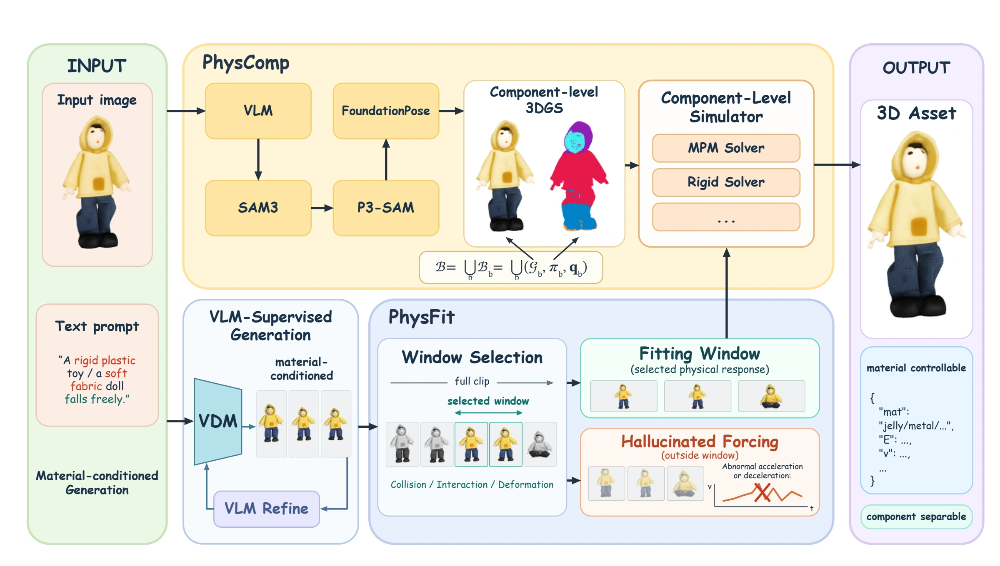
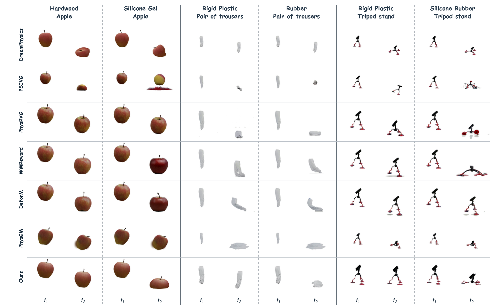
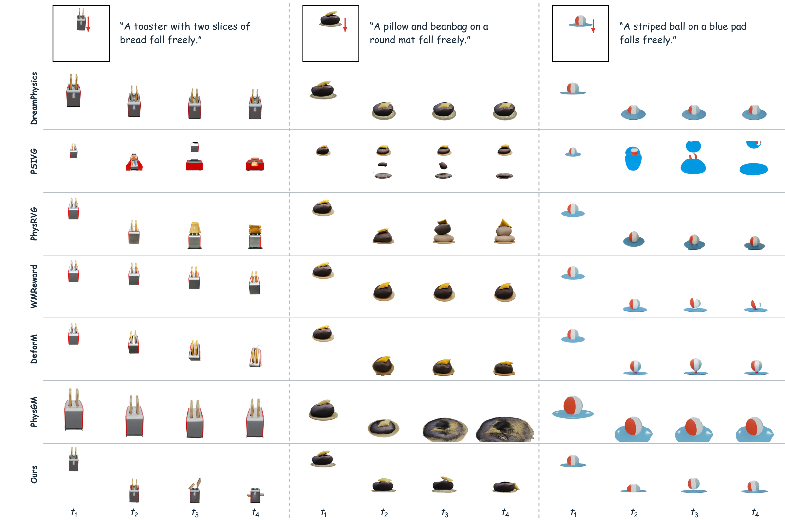

<h1 align="center">PhysForge: Material-Controllable 3D Reconstruction with Separable Components</h1>

  
  

<strong>Code to be released.</strong>

## Abstract

Recent advances in physical 3D generation have enabled visually faithful assets with simulatable mechanical behavior. However, existing methods provide limited control over material behavior beyond appearance-based inference and struggle to estimate physical properties from complex interactions between objects and semantic parts. Therefore, we present **PhysForge**, a Video Diffusion Model (VDM)-based framework for addressing these challenges, comprising two complementary modules for material-controllable physical fitting and component-level interaction modeling. The first, **PhysFit**, leverages material-conditioned VDM dynamics as references for physical-property fitting, introducing windowed fitting to focus on material-revealing interactions and Hallucinated Forcing to disentangle nonphysical motion hallucinated by the VDM from material responses. The second, **PhysComp** decomposes complex interactions into individual objects and semantic components, enabling their physical parameters to be optimized independently and flexibly composed for joint simulation. Experiments on PhysAssets and Google Scanned Objects demonstrate that, compared with existing methods, **PhysForge** provides stronger control over material-dependent physical responses while supporting component-level physical modeling for complex interactions. It achieves the best CLIP and physical controllability scores on both common and uncommon materials, with qualitative comparisons, component-level ablations, and a user study further supporting these improvements.

## Contribution

- **PhysForge** constructs physically simulatable 3D assets with controllable material behavior and separable semantic components, enabling material specification beyond appearance-based inference.
- **PhysFit** uses material-conditioned video dynamics for physical-property estimation, focusing optimization on informative interaction windows while accounting for nonphysical generated motion.
- **PhysComp** independently optimizes the physical properties of objects and semantic parts, then composes them into simulation groups according to their relative motion.

## Overview

Given an input image and a target material description, PhysForge uses PhysFit to fit material properties from informative intervals of generated video dynamics while accounting for nonphysical motion, and PhysComp to reconstruct separable objects and semantic parts, estimate their physical properties independently, and compose them in a shared simulation.

## Results

### Material-Controllable

> Comparison of PhysForge and baseline methods under different material conditions.

### Component-Separable

> Comparison of PhysForge and baseline methods on component separation.

### Quantitative comparison

> Comparison of PhysForge and baseline methods on CLIP alignment and physical controllability.

<table>
  <thead>
    <tr><th align="center" rowspan="2">Method</th><th align="center" colspan="2">Common&nbsp;materials</th><th align="center" colspan="2">Uncommon&nbsp;materials</th></tr>
    <tr><th align="center">CLIP&nbsp;↑</th><th align="center">PC&nbsp;↑</th><th align="center">CLIP&nbsp;↑</th><th align="center">PC&nbsp;↑</th></tr>
  </thead>
  <tbody>
    <tr><th align="center">DreamPhysics</th><td align="center">0.250</td><td align="center">3.2</td><td align="center">0.248</td><td align="center">2.6</td></tr>
    <tr><th align="center">PSIVG</th><td align="center">0.233</td><td align="center">2.0</td><td align="center">0.241</td><td align="center">1.8</td></tr>
    <tr><th align="center">PhysRVG</th><td align="center">0.243</td><td align="center">3.8</td><td align="center">0.232</td><td align="center">3.0</td></tr>
    <tr><th align="center">WMReward</th><td align="center">0.246</td><td align="center">4.4</td><td align="center">0.244</td><td align="center">2.6</td></tr>
    <tr><th align="center">DeforM</th><td align="center">0.242</td><td align="center">4.4</td><td align="center">0.235</td><td align="center">3.2</td></tr>
    <tr><th align="center">PhysGM</th><td align="center">0.246</td><td align="center">3.8</td><td align="center">0.247</td><td align="center">1.8</td></tr>
    <tr><th align="center"><strong>PhysForge</strong></th><td align="center"><strong>0.258</strong></td><td align="center"><strong>4.6</strong></td><td align="center"><strong>0.264</strong></td><td align="center"><strong>4.0</strong></td></tr>
  </tbody>
</table>

### User study

> User-study rankings of PhysForge and baseline methods.

<table>
  <thead>
    <tr><th align="center">Metric</th><th align="center">DreamPhysics</th><th align="center">PSIVG</th><th align="center">PhysRVG</th><th align="center">WMReward</th><th align="center">DeforM</th><th align="center">PhysGM</th><th align="center">PhysForge</th></tr>
  </thead>
  <tbody>
    <tr><th align="center">Win&nbsp;rate&nbsp;(%)&nbsp;↑</th><td align="center">5.56</td><td align="center">0.56</td><td align="center">8.33</td><td align="center">12.22</td><td align="center">2.78</td><td align="center">10.00</td><td align="center"><strong>60.56</strong></td></tr>
    <tr><th align="center">Average&nbsp;rank&nbsp;↓</th><td align="center">4.2778</td><td align="center">6.2167</td><td align="center">3.9500</td><td align="center">3.5444</td><td align="center">3.6833</td><td align="center">4.4222</td><td align="center"><strong>1.9056</strong></td></tr>
  </tbody>
</table>

